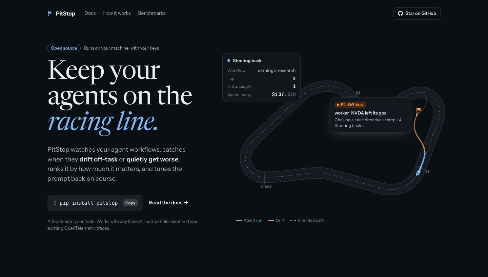
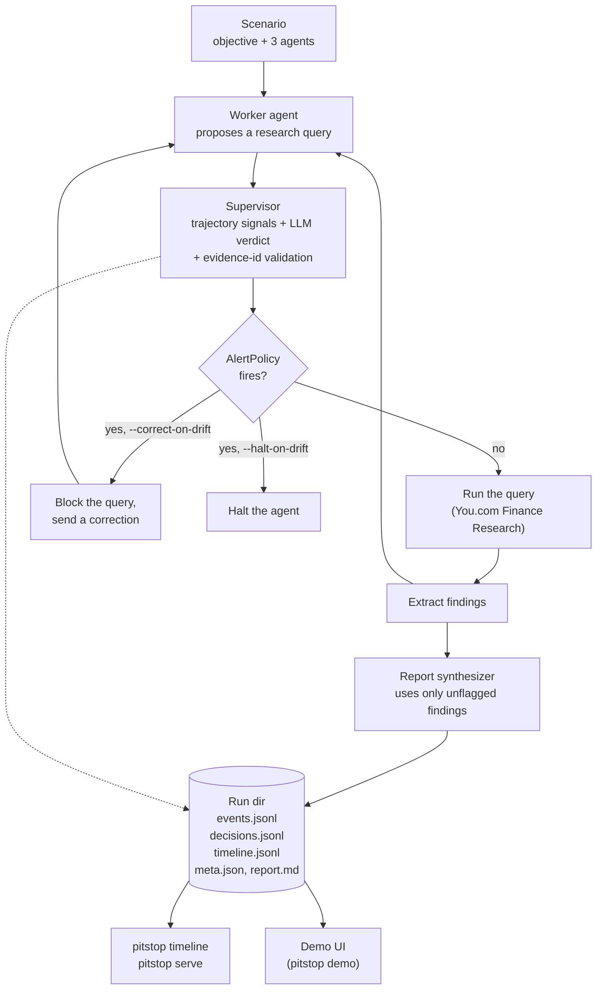
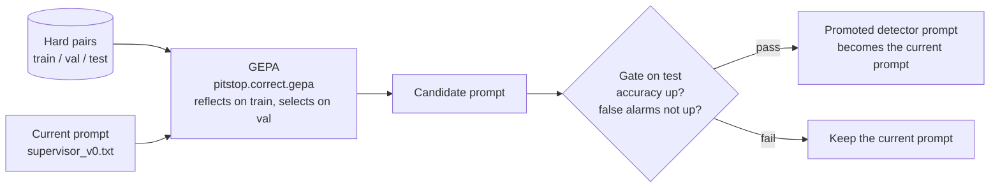
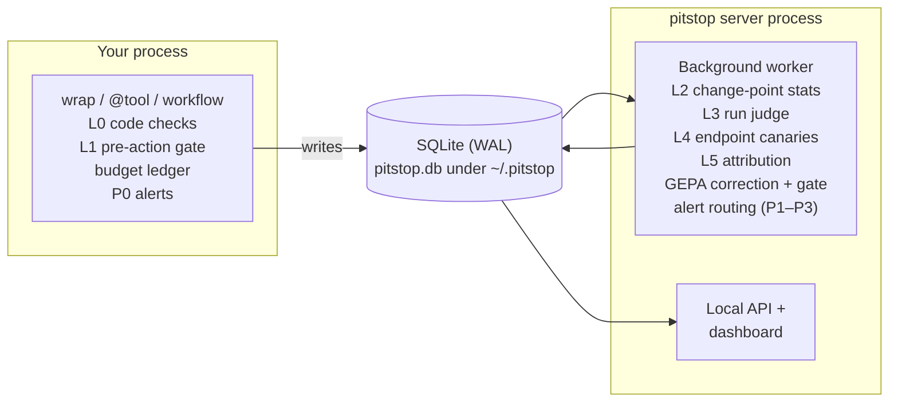
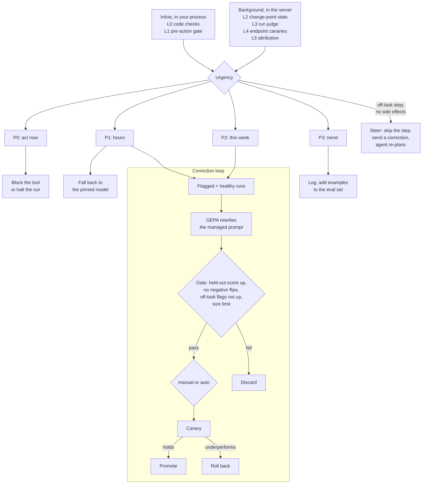

# PitStop

Keep your agents on the racing line: drift detection and GEPA-powered prompt correction for agent workflows. Open source, runs on your machine.

[](https://github.com/Qamil-Mirza/gepa-financial-agent/actions/workflows/ci.yml)
[](LICENSE)
[](pyproject.toml)



<sub>Still from the landing-page mockup. The `pip install pitstop` shown there is planned; the package is not on PyPI yet.</sub>

## Why PitStop

Agents drift in two ways. They go **off-task**: chasing a stale directive, looping, or reporting a figure their evidence does not support. Or they **degrade**: still on the right task, but quality, tool calls or cost quietly get worse after a model, provider or prompt change. Some drift needs action within seconds (an off-task call to a tool with side effects), some can wait for a weekly fix. Existing observability tools stop at the alert; PitStop is meant to also steer the agent back in the moment and rewrite the prompt that caused the drift.

> **Status: pre-release.** Today the repo contains the drop-in Python SDK (drift detection, steering and hard dollar budgets), the CLI to inspect it, the PitStop research-swarm runtime with its drift supervisor, the GEPA calibration tooling and benchmarks. The local dashboard and agent-prompt correction are on the [Roadmap](#roadmap).

## Quickstart (run the example)

You need [uv](https://docs.astral.sh/uv/) and Python 3.11 or newer.

```sh
git clone https://github.com/Qamil-Mirza/gepa-financial-agent.git
cd gepa-financial-agent
uv sync
uv run pitstop demo
```

Then open http://127.0.0.1:8770. The demo works offline: it replays a bundled snapshot of a real paired run, in which two Nemotron Nano supervisors (the original prompt and the GEPA-rewritten prompt) each watch and correct their own three research agents. Use `--port` if 8770 is taken, for example `uv run pitstop demo --port 8771`.

**With keys (paid calls).** To run the swarm live on Crusoe Managed Inference and the You.com Finance Research API:

```sh
cp .env.example .env       # fill in CRUSOE_API_KEY and YDC_API_KEY
uv run pitstop check       # one Crusoe inference call per configured model
uv run pitstop run --correct-on-drift
```

`pitstop run` requires both keys. It makes Crusoe inference calls and up to `PITSTOP_MAX_RESEARCH_CALLS` (default 12) live You.com calls per run; cached answers are reused for free. With `--correct-on-drift`, a query the supervisor flags is blocked and the agent receives a correction instead.

Runs are written to `~/.pitstop/runs/<run_id>/`. Set `PITSTOP_HOME` to move the whole state directory, or `PITSTOP_RUNS_DIR` to move only the runs. Other commands:

| Command | What it does |
|---|---|
| `uv run pitstop timeline --run-dir <run dir>` | Rebuild and print the curated drift timeline of a run (`--highlights` for flags and responses only) |
| `uv run pitstop serve` | JSON + server-sent-events API over your runs' timelines, on port 8765 |
| `uv run pitstop compare --run-dir <run dir> --prompt-b <prompt.txt>` | Re-judge a recorded run's exact supervisor inputs with two prompts, side by side; no new research calls (requires keys) |
| `uv run pitstop run --shadow-prompt <prompt.txt>` | Run a second supervisor prompt on the same inputs, logged but never acting (requires keys) |

## Add PitStop to your agent

The SDK works with any OpenAI-compatible client and with the Anthropic SDK (`pip install "pitstop[anthropic]"`). Wrap the client, mark the workflow, and guard your tools:

```python
import pitstop

client = pitstop.wrap(OpenAI(base_url=..., api_key=...))      # metered, drift-checked
# or: client = pitstop.wrap(Anthropic())                       # the same, for client.messages.*
SYSTEM = pitstop.prompt("support.system", "You are a support agent...")   # versioned; your edits win

@pitstop.tool                       # read-only: loops are steered, then halted
def search(query): ...

@pitstop.tool(side_effects=True)    # off-task calls to this are blocked
def send_report(to, body): ...

with pitstop.workflow("support", goal="Answer the ticket", criticality="medium",
                      budget_usd=1.0, tools=("search", "send_report")):
    run_agent(client)               # raises pitstop.Halted or pitstop.BudgetExceeded when it must stop
```

State lives in `~/.pitstop` (or `$PITSTOP_HOME`). If you pass a custom home instead, call `pitstop.init(home=...)` first, before any other PitStop call: the first wrapped call, tool, prompt or workflow otherwise initializes the default home. Catch `pitstop.BudgetExceeded` before `pitstop.Halted`, since it is a subclass.

Steering is counted per run, not per agent: parallel agents in one workflow (for example several `pitstop.agent(...)` scopes under `asyncio.gather`) share the run's budget of 2 steers, and the next steer after that halts the whole run.

`pitstop.workflow(...)` (and `pitstop.agent(...)`) can also decorate a generator or async generator function: the run opens on the first step and ends when the generator finishes, raises or is closed. Code that consumes the generator between yields runs outside the run. Each step runs in the consumer's own task, so an `asyncio.timeout` or task group that spans a `yield` inside the generator keeps working.

Metered methods (on the client, on `with_options(...)`/`copy()` clients, and under `with_raw_response` / `with_streaming_response` where the SDK offers them): `chat.completions.create`, `chat.completions.parse` and `chat.completions.stream`; `responses.create`, `responses.parse` and `responses.stream`; and legacy `completions.create`, sync and async. On an Anthropic client (`Anthropic` / `AsyncAnthropic`): `messages.create` (also with `stream=True`), `messages.parse` and `messages.stream`, and the same three under `beta.messages`, whose streams keep `text_stream`, `get_final_message()` and `get_final_text()` working as unwrapped. Anthropic cache writes are charged at their write premium, never under it: 1.25x the input price for 5-minute writes and 2x for 1-hour writes (2x when the response does not break them down), and cache reads at the cached price. A `stop_reason` of `"refusal"` counts as a refusal for drift detection. A `claude-*` model with no price entry is priced at a conservative $15 / $75 per million input / output tokens until you add a `[prices."<model>"]` override (see [docs/config.example.toml](docs/config.example.toml)). A stream helper (`.stream(...)`) reserves when it is called, settles when its `with` block exits, and releases its reservation if the manager is never entered. A Responses call with `background=True` (or one that returns still `queued` / `in_progress`) is charged its full reservation, because its output is billed after the call returns and polling with `responses.retrieve` is not metered. A background stream read to its end settles from its real usage. Resuming a stored response with `responses.stream(response_id=...)` is metered as a new call, so it can count that response twice (over-counted, never under-counted). With `previous_response_id` or `conversation`, the earlier turns are not in the request, so the prompt estimate (and the reservation checked against the budget) is small; the call still settles from the provider's real usage. `beta.messages.tool_runner` is metered too: each model call the runner makes is reserved and settled as its own call. Not metered yet: the Assistants, Realtime and Batch APIs (including Anthropic `messages.batches`), and every other `client.beta.*` method (OpenAI's included). Every other method is passed through unchanged, so calls through those APIs are neither budgeted nor recorded.

Only calls on the default `agent` meter feed drift detection and set the run's model. PitStop's own judge, supervisor and GEPA calls inside a run are metered against the budget but never counted as the agent's behavior; each `llm_call` event records its `meter`.

### Pre-action gate

Before a `@pitstop.tool(side_effects=True)` tool runs inside a `high` or `medium` workflow, and after the L0 checks let it through, a judge model is asked whether this one call serves the workflow's goal (and the agent's goal, if set). It sees the goals, the tool name, its arguments (first 2,000 characters) and the agent's last 5 tool calls; the prompt is frozen and versioned (`l1_gate_v1`). Read-only tools and `low` workflows are never gated. A "no" is recorded as an `out_of_scope_action` drift (P0) and the tool returns the usual `{"blocked_by": "pitstop", "reason": ...}` instead of running; on a `high` workflow the run also halts at its next call boundary. Every verdict is a `gate` event.

Each gated call costs one judge call and adds roughly 0.5–1.5 s of latency. Judge calls go through the `watch` meter: they count against your budgets (a budget hit raises `BudgetExceeded` from the tool call) but never feed drift detection. Async tools run the judge in a worker thread, not on the event loop.

The judge is configured in `[judge]` in `config.toml` (default: `openai/gpt-oss-120b` on Crusoe, key read from `CRUSOE_API_KEY`, 10 s timeout, no retries; see [docs/config.example.toml](docs/config.example.toml)). To use your own client, pass a sync OpenAI-compatible client: `pitstop.init(judge_client=OpenAI(...), judge_model="...")` (PitStop wraps it; an async client is refused and counts as no judge). Pick a model from a different family than your agent where you can, and prefer a fast non-reasoning model: a reasoning model spends tokens and seconds thinking before it answers (the judge call allows up to 2,048 output tokens). The judge is resolved once per runtime: a key exported later takes effect after a restart, `pitstop.sdk.runtime.reset_runtime()` or `pitstop.init(judge_client=...)`.

When the judge is missing, times out, errors or returns no usable verdict, the workflow's failure policy decides: `high` workflows block the call (fail closed) and `medium` workflows run it (fail open). Override it per workflow with `pitstop.workflow(..., on_gate_error="block" | "allow")`. Every failure is recorded as a `gate_error` event with the policy applied; a blocked call's reason says how to fix it (configure `[judge]` or set `on_gate_error="allow"`). So with no judge configured, side-effect tools on `high` workflows do not run.

Try it without keys: `uv run python examples/quickstart/agent.py --offline --inject-loop` (see [examples/quickstart](examples/quickstart/README.md)). Then inspect the local state:

```text
$ uv run pitstop drifts
 id  level  workflow    drift_type         action  evidence
 1   P1     quickstart  unproductive_loop  steer   3
$ uv run pitstop status      # per-workflow runs, open drifts by level, spend and last status
$ uv run pitstop budget      # configured budgets: spent, limit, remaining
```

The `evidence` column counts every occurrence of the drift; the DB keeps the newest 20 evidence entries per drift.

### Fallback

Pin a known-good model on a workflow with `pitstop.workflow(..., fallback_model="...")`. The fallback engages when all of these hold:

- a P1 `tool_call_breakage` or `refusal_spike` drift is detected in a run (a `low` workflow's P2 never engages it);
- the run's model or provider `base_url` changed in the last 24 hours: it differs from the workflow's previous setup, and the first run on the new setup started less than a day ago (a breakage with no recent change is only recorded). Runs that went to the pinned model don't count as a setup, so clearing the fallback and going back to your old model is not a change, while a switch you made while the fallback was on still is;
- the run is not already on the pinned model.

From the next call on, every agent-meter call in that workflow is sent to the pinned model instead of the one your code asked for; the agent sees no other difference. The reservation, cost and `llm_call` event use the pinned model, and the event records the requested one as `fallback_from`. The drift's action is `fallback`, and a `fallback` event records `{"from", "to", "change"}`. Judge and supervisor calls (other meters) and calls outside the workflow are never swapped. If PitStop cannot read its state, the call keeps its own model.

Only the model id is swapped: the call still goes to the client's own `base_url`. Every agent-meter client in the workflow sends the pinned id, and after a fallback engaged by a `base_url` change it goes to the new provider. Pick a `fallback_model` that every endpoint the workflow calls actually serves.

The fallback is sticky: it stays on across runs and processes until you clear it, since only you can tell when the new model or provider is fixed:

```text
$ uv run pitstop fallback status        # workflow, pinned model, since, the change that engaged it
$ uv run pitstop fallback clear support # the next call goes back to the requested model
```

### Alerts

Drifts are routed by urgency (P0-P3, see the [design spec](docs/superpowers/specs/2026-10-20-pitstop-runtime-design.md) §5):

| Level | Meaning | Default route |
|---|---|---|
| **P0** | Act now: off-task side-effect tool, budget hit, loop on a high-criticality workflow | PagerDuty, Opsgenie, Slack, webhook (sent right away) |
| **P1** | Hours: tool-call or refusal spike, quality step after a model/provider change | Slack, email, webhook (sent right away) |
| **P2** | This week: quality degrading within contract | Daily digest: email, Slack, webhook |
| **P3** | Trend: topic shift, slow token or latency creep | Daily digest: email, Slack, webhook |

Every alert says what drifted, what likely changed (the run's model or provider change in the last 24 hours, or "no change detected" with the run's model and `base_url`) and what PitStop did (blocked, steered, halted, fell back or recorded). P0/P1 alerts are sent from a background thread, so a slow channel never blocks your agent, and it finishes sending before the process exits (a normal exit or an uncaught exception such as `Halted`; not a kill). Each open drift alerts once per channel (deduplicated per workflow and drift type); a drift that escalates from P1 to P0 alerts again. A P0/P1 send that fails with a network error, a 5xx or a 429 is retried twice (after 0.5 s and 1 s); a send that still fails is retried at the drift's next occurrence, and a send left unfinished by a killed process stops blocking after 2 minutes. Each attempt is a row in the `alerts` table (`sent` or `failed` with an error such as `HTTP 500`).

A channel is used only when its `[alerts.<channel>]` table is in `config.toml` **and** its env var is set. Secrets live only in environment variables: `config.toml` holds the variable's name, and an inline `routing_key`, `api_key`, `webhook_url`, `password` or `url` is rejected as an invalid config. PitStop never stores or logs a secret (it hides httpx's own request log line while sending), but third-party HTTP instrumentation in your process can still record the full Slack or webhook URL: for example Sentry's httpx breadcrumbs or the OpenTelemetry HTTPX instrumentor. Scrub those URLs there, or keep that instrumentation off in processes that send alerts.

| Channel | Table | Secret env var (default) | Notes |
|---|---|---|---|
| PagerDuty Events v2 | `[alerts.pagerduty]` | `PAGERDUTY_ROUTING_KEY` (`routing_key_env`) | P0 critical, P1 error; SMS and phone calls go through PagerDuty or Opsgenie |
| Opsgenie | `[alerts.opsgenie]` | `OPSGENIE_API_KEY` (`api_key_env`) | `region = "us"` or `"eu"` |
| Slack incoming webhook | `[alerts.slack]` | `SLACK_WEBHOOK_URL` (`webhook_url_env`) | the webhook URL is a secret |
| Email (SMTP) | `[alerts.email]` | `SMTP_PASSWORD` (`password_env`, only with `username`) | `smtp_host`, `smtp_port` (587), `starttls` (true), `from_addr`, `to` |
| Generic webhook | `[alerts.webhook]` | `PITSTOP_WEBHOOK_URL` (`url_env`) | JSON POST of the alert plus `title` and `body`; any 2xx is success |

Change the routes with `[alerts.routes]` (`P0`, `P1` and `digest`, each a list of channel names). Check your setup, then schedule the digest:

```text
$ uv run pitstop alerts test                  # one test alert per channel: sent, failed: <reason> or not configured
$ uv run pitstop alerts test --channel slack
$ uv run pitstop alerts digest                # open P2/P3 drifts not yet sent; at most once per 24 h (cron it);
                                              # exits 1 when every channel failed
$ uv run pitstop alerts digest --force        # send now regardless of the last digest
```

## Set a hard budget

Copy [docs/config.example.toml](docs/config.example.toml) to `~/.pitstop/config.toml`. Each `[budgets.<name>]` entry sets a dollar limit for a provider `base_url` and period. Every model call reserves its worst-case cost first, and once the limit would be crossed the call raises `BudgetExceeded` before it reaches the provider. PitStop's own calls (supervisor, judge, GEPA) count against the same budget. A per-workflow cap is the `budget_usd` argument of `pitstop.workflow`. An invalid `config.toml` (a bad period, limit or timezone) never silently removes a budget: `pitstop.init()` raises a `ValueError`, every metered call, `pitstop.prompt` and `pitstop.workflow` (and any guarded tool inside a workflow) raises `pitstop.Halted("pitstop config invalid: ...")` before reaching the provider, and `pitstop status`/`drifts`/`budget` print the error and exit 2. A `pitstop.db` written by a newer PitStop is refused the same way, so a downgrade never runs without its budgets.

A process that dies mid-call leaves its worst-case reservation counting against the budget. `pitstop budget reconcile` lists reservations still open after 60 minutes (`--older-than-min N` to change that): they were left by processes that died or by calls still running. `--release` frees them and lists what it freed, so only use it once those calls are done.

## How it works today

### One run of the research swarm

A scenario gives three research agents a shared objective. Before each agent's proposed research query is sent, the supervisor judges it. Code computes trajectory signals (for example, near-duplicate queries and steps since the last finding), a Nemotron model returns a verdict (ON_TRACK, DRIFTING or UNCERTAIN) with the evidence event ids it relied on, and code rejects evidence ids that do not exist in the trajectory. The alert policy fires on a confident DRIFTING verdict (confidence at least 0.75) or on two DRIFTING verdicts in a row at confidence at least 0.5.



### Calibrating the detector prompt

The supervisor's prompt is calibrated offline with GEPA on labeled hard pairs: 18 drift categories, each with a drift case and a healthy twin. Train is NVIDIA, val is Broadcom and test is AMD; GEPA never sees test. The gate promotes a candidate only if its test accuracy beats the current prompt and it raises no more false alarms.



The code is in [benchmarks/calibration](benchmarks/calibration): `loop.py` runs the recursive swarm → judge → mine → optimize → gate loop, and `optimize.py` runs a single GEPA optimization whose output you compare with `benchmarks.hard_pairs.run_hard_cases`. The GEPA engine itself is in [src/pitstop/correct](src/pitstop/correct). The hackathon's GEPA prompts are in `src/pitstop/assets/prompts/gepa/`; `pitstop run` still defaults to the hand-written `supervisor_v0.txt` (pass `--prompt` to use another).

## Where it's going (architecture)

> **Planned (milestones 2–4).** Nothing in this section exists in the repo yet. Full design: [docs/superpowers/specs/2026-10-20-pitstop-runtime-design.md](docs/superpowers/specs/2026-10-20-pitstop-runtime-design.md).

### Runtime

A few lines in your code (`wrap`, `@tool`, `workflow`) record every step to a local SQLite file. Inline checks and budgets run in your process and never depend on the server. A separate server process runs the heavier detection layers, correction and alert routing, and serves a local dashboard.



### Detection, urgency and correction

Each layer emits signals that map to an urgency level, and the level decides the in-the-moment action. Confirmed P1/P2 drift starts the correction loop, which rewrites only prompts registered with `pitstop.prompt` and scores candidates with a task-quality scorer, never with the drift detector.



## Repo map

```
src/pitstop/          the installable package and the `pitstop` CLI
  sdk/, detect/, budget/  the drop-in SDK, drift detection and urgency, the budget ledger
  agents/             research worker agents and the report synthesizer
  supervisor/         drift supervisor: signals, LLM verdict + evidence validation, AlertPolicy, corrections
  correct/            the GEPA engine (pitstop.correct.gepa) and its model clients
  research/           You.com Finance Research client with an on-disk cache
  demo/               the GEPA comparison demo server, its static page and the bundled snapshot
  ui/                 a prototype local run viewer (python -m pitstop.ui.server)
  assets/             packaged prompts (baseline, GEPA, worker) and scenarios
examples/quickstart/  a keyless demo agent that shows steer-then-halt
benchmarks/
  hard_pairs/         the labeled hard-pairs eval (18 categories, drift + healthy twins) and its runner
  calibration/        GEPA calibration of the detector prompt and the recursive loop with its gate
  held_out/           builder for the harder held-out set (unseen companies, distractors)
  synth/              the synthetic drift-trace generator (real workers, real You.com evidence)
tests/                offline test suite: runtime, correct, benchmarks, repo hygiene
docs/                 design specs and plans (docs/superpowers/), hackathon-era documents (docs/history/)
```

## Benchmarks

**Hard pairs, AMD test split.** Train is NVIDIA and val is Broadcom; GEPA never saw this split. Each arm has 36 cases × 5 trials = 180 judgments, and an alert fires on DRIFTING at confidence ≥ 0.75.

| Supervisor | Prompt | Accuracy (5-trial range) | Drift caught | False alarms (of 180) |
|---|---|---|---|---|
| Nano 30B | original | 0.817 (0.778–0.861) | 0.667 | 3 |
| Nano 30B | GEPA (`pitstop_nano_800`) | **0.878** (0.861–0.917) | 0.756 | **0** |
| Super 120B | original | 0.861 (0.833–0.917) | 0.789 | 6 |
| Super 120B | GEPA (`pitstop_super_600`) | **0.956** (0.917–0.972) | 0.933 | 2 |

The small model with a rewritten prompt roughly matches the 4× larger model with the original prompt (0.878 vs 0.861; the trial ranges overlap). Nano's GEPA run took 29 minutes and cost about $0.70.

**Limitations.** Read these before relying on the numbers.

- **Small test set.** The test split is 36 cases. Per-case sign tests are not significant (Nano p = 0.69, Super p = 0.125), even though the gains are consistent across trials.
- **Weak transfer.** The test split shares its 18 categories with train and differs only by company. On the harder held-out set (unseen companies and close-call distractors), Nano fails with either prompt, flagging 75–81% of healthy steps. On the earlier team synthetic dataset, GEPA mostly shifted which drift types the supervisor favoured, so it was not promoted.
- **Longer prompts.** The GEPA prompts grew about 5× (Nano: 1.6k to 7.8k characters), and Nano checks got about 30–40% slower.
- **The gate rejected the recursive loop's first round.** Round 0 raised test accuracy (0.844 → 0.867) but also false alarms (1 → 11), so the current prompt was kept.
- **Synthetic data.** The hard-pairs trajectories are synthetic and their figures are illustrative. One rule in the Nano GEPA prompt still quotes an NVIDIA train figure.

**Reproduce** (requires `CRUSOE_API_KEY`; Crusoe inference only, no You.com):

```sh
uv run python -m benchmarks.hard_pairs.run_hard_cases --splits test --trials 5 \
    --model nvidia/NVIDIA-Nemotron-3-Nano-30B-A3B \
    --prompt src/pitstop/assets/prompts/gepa/pitstop_nano_800.txt
```

Results go to `~/.pitstop/runs/eval-<prompt>-<timestamp>/`. The baseline result files are in [benchmarks/hard_pairs/results](benchmarks/hard_pairs/results). The raw hackathon traces and generated datasets are not committed; they are archived as a GitHub release asset (`pitstop-hackathon-data-2026-10-20.tar.gz`). The full hackathon write-up is in [docs/history/PITSTOP_RESULTS.md](docs/history/PITSTOP_RESULTS.md).

## Roadmap

From the [design spec](docs/superpowers/specs/2026-10-20-pitstop-runtime-design.md), §10. There is no fixed deadline.

1. **Cleanup and restructure. Done.** One installable package, the example agent still runs, tests pass in one command.
2. **SDK and detection.** M2a is done: `wrap`, `workflow`, `agent`, `tool`, `prompt`, the hard-stop budget ledger, L0 detection with P0-P3 urgency, steer/block/halt actions, and the `pitstop status`, `pitstop drifts` and `pitstop budget` commands. M2b is done: hardened config and store (schema v4, migrations, `pitstop budget reconcile`), `wrap` for the OpenAI and Anthropic SDKs, the L1 pre-action gate, fallback to a pinned model, and P0/P1 alerts (PagerDuty, Opsgenie, Slack, email, webhook). M2c is next: an OpenTelemetry span processor with verdicts as span events, OpenAI Agents SDK and LangGraph adapters, L2 change-point statistics, L5 attribution, a background `scan` pass, and moving the research swarm to `examples/financial-research/`.
3. **Dashboard. Planned.** Pit wall, run graph, what changed, runs and settings on real data, plus the L3 run judge and L4 endpoint canaries. The first end-to-end demo.
4. **Correction. Planned.** Managed prompts, replay, the GEPA loop with its gate, manual and auto modes, canary and rollback.
5. **Later. Not designed yet.** Remote collection over HTTP, more framework adapters, editing settings from the UI, a LiteLLM gateway plugin.

## Contributing

See [CONTRIBUTING.md](CONTRIBUTING.md) for setup, tests and pull requests. The test suite runs offline: `uv run pytest`.

## License

[Apache-2.0](LICENSE).

## Acknowledgements

PitStop started at the Crusoe x Cerebral Valley Recursive Agents Hackathon (October 2026, San Francisco), built on Crusoe Managed Inference by Qamil Mirza, Gautam Bhooma and Arjun Mittal. Prompt optimization uses [GEPA](https://github.com/gepa-ai/gepa) (the `gepa` library). Research agents use the You.com Finance Research API.

The post-hackathon redesign was built extensively with [Claude Code](https://claude.com/claude-code). That includes the research, the design spec, the restructure, the README and the tests.
